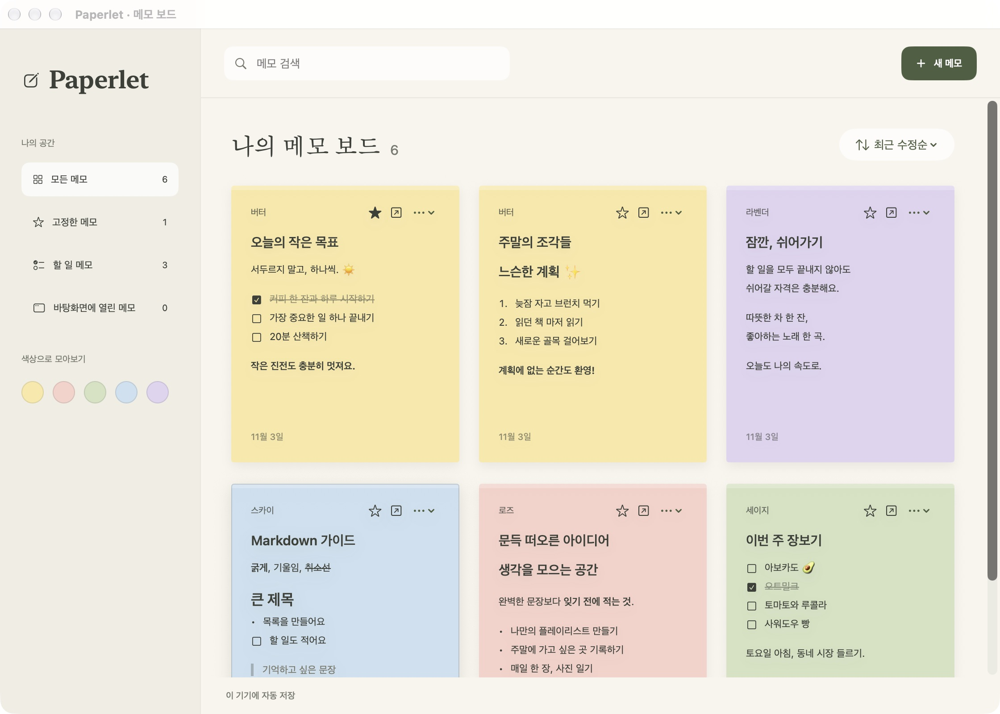

# Paperlet

마크다운을 지원하는 macOS 포스트잇 메모 앱입니다. 보드에서 메모를 모아보거나 바탕화면에 개별 스티키 창으로 띄워둘 수 있습니다.



## 기능

- 5가지 색상의 메모 작성, 검색, 정렬 및 보드 상단 고정
- 마크다운 문법(제목, 목록, 체크리스트, 인용구, 인라인 서식) 렌더링 및 할 일 체크박스 토글
- 메모를 바탕화면 개별 창으로 분리, 항상 위 고정 및 편집 잠금
- 전체 / 고정한 메모 / 할 일 메모 / 바탕화면에 열린 메모 및 색상별 필터

## 실행 방법

```sh
git clone https://github.com/INT31302/Paperlet.git
cd Paperlet
open 'Untitled Project.xcodeproj'
```

Xcode에서 **MyApp** 스킴과 **My Mac**을 선택해 실행합니다.

## 구조

- `MyApp/` — 메모 보드, 마크다운 파서·편집기, 바탕화면 스티키 윈도우 관리
